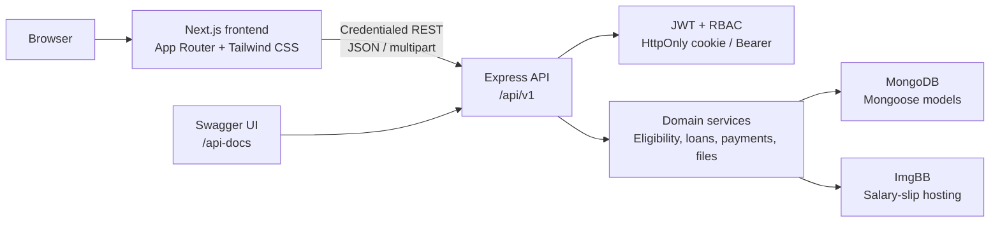
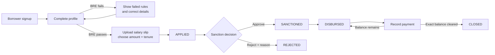

# CreditSea Loan Management System

CreditSea is a role-aware Loan Management System that manages the complete lending lifecycle: borrower onboarding, eligibility assessment, loan application, sanction, disbursement, repayment, and automatic closure.

The project is organized as one repository containing two independently runnable applications:

- `frontend/`: Next.js borrower and operations interface.
- `backend/`: Express REST API with authentication, RBAC, business rules, persistence, file handling, and Swagger documentation.

## Product capabilities

- Borrower signup, login, profile completion, and current-loan tracking.
- Server-side business rule engine (BRE) for age, salary, PAN, and employment mode.
- Salary-slip upload with PDF/JPG/PNG validation, ImgBB storage, and protected preview.
- Fixed 12% simple-interest calculation with amount and tenure limits.
- Role-specific Sales, Sanction, Disbursement, and Collection workspaces.
- Approval, rejection with reason, disbursement, partial repayment, and automatic closure.
- Paginated operations queues and history views with tab-specific search and status filters.
- Admin-only deletion of eligible non-financial records with confirmation UI.
- HttpOnly JWT cookie authentication with Bearer-token compatibility for API clients.
- Toasts, inline errors, loading states, empty states, bottom-right format tooltips, and responsive layouts.
- Designed frontend 404 and authenticated 403 states.

## Architecture



### Request and responsibility boundaries

1. The browser collects form input and provides immediate usability feedback.
2. The frontend sends credentialed requests to the versioned API at `/api/v1`.
3. Authentication middleware verifies the session token and attaches the trusted user identity to the request.
4. RBAC middleware checks whether the user's role owns the requested route.
5. Zod schemas, service rules, and Mongoose validation protect the final server boundary.
6. Services calculate and persist the authoritative loan and payment state.
7. Public serializers keep password hashes, JWTs, and hosted file-management URLs out of API responses.

The frontend is not the security boundary. A hidden button or unavailable navigation item never replaces backend authentication and authorization.

## AI-assisted engineering approach

AI was used as an engineering copilot throughout the development of CreditSea, with the repository, runtime behavior, and verification commands treated as the source of truth. The goal was to use AI for higher-leverage reasoning and iteration rather than blindly generating unreviewed code.

### How AI contributed

- Converted the product brief into an implementation plan covering borrower onboarding, BRE rules, loan status transitions, operations ownership, repayment, and closure.
- Reviewed the codebase structure before changes and suggested focused changes that fit the existing Next.js and Express architecture.
- Helped design the API contract, including versioning under `/api/v1`, consistent error responses, role-protected routes, cookie authentication, pagination, search, and Swagger examples.
- Identified edge cases such as failed eligibility, duplicate active loans, invalid transitions, duplicate UTRs, overpayments, concurrent payment updates, upload failures, and role-mismatched navigation.
- Assisted with frontend usability improvements including toast feedback, loading states, independent tab searches, stable tab loading, bottom-right tooltips, immediate navbar identity updates, and designed 404/403 states.
- Helped keep product, technical, testing, video-demo, and repository documentation aligned with the implemented behavior.
- Reviewed repository hygiene for GitHub readiness, including ignored secrets, generated artifacts, dependency folders, build output, and reusable environment templates.

### Engineering workflow

```text
Understand requirements
        |
        v
Inspect current repository and runtime contracts
        |
        v
Propose the smallest compatible implementation
        |
        v
Apply changes incrementally with human review
        |
        v
Run formatting, builds, API smoke checks, and manual-flow tests
        |
        v
Update documentation to match the verified implementation
```

AI suggestions were checked against the actual route definitions, validators, services, models, frontend state, and environment configuration. Security-sensitive behavior was implemented and verified at the backend boundary, not inferred from frontend presentation. Credentials and runtime secrets remain in ignored local environment files and are not part of the repository context.

This approach made AI useful across the full engineering loop: discovery, design, implementation, review, testing, documentation, and release preparation.

## Loan lifecycle



The backend enforces the valid transitions. A borrower cannot create another active application while an `APPLIED`, `SANCTIONED`, or `DISBURSED` loan exists.

## Roles and workspaces

| Role | Workspace responsibility |
| --- | --- |
| Borrower | Complete profile, pass the BRE, submit an application, and track the current loan |
| Sales | View registered borrowers who have not submitted a loan application |
| Sanction | Review applied loans and approve or reject them with a reason |
| Disbursement | Mark sanctioned loans as disbursed and review disbursement history |
| Collection | Record repayments and review payment history |
| Admin | Access all operations modules and permitted non-financial cleanup controls |

Role permissions are enforced in the API. Directly opening a role-owned frontend route with the wrong authenticated account displays a designed 403 state. Unknown frontend paths display a designed 404 page.

## Technology stack

| Layer | Technology |
| --- | --- |
| Frontend | Next.js 14 App Router, React 18, TypeScript, Tailwind CSS |
| Backend | Node.js, Express 4, TypeScript |
| Persistence | MongoDB with Mongoose 8 |
| Validation | Zod, Mongoose validation, browser constraint validation |
| Authentication | JWT, bcryptjs, HttpOnly cookie sessions, optional Bearer header |
| File handling | Multer memory storage, ImgBB upload and protected proxy preview |
| API documentation | OpenAPI 3.0.3 with Swagger UI |

The frontend uses React Context for global authentication and toast state. Form, table, search, pagination, and modal state remains local to the relevant page/module; Redux or Zustand is not required for the current scope.

## Repository layout

```text
.
|- backend/
|  |- scripts/seed.ts
|  `- src/
|     |- config/          environment, database migration, Swagger
|     |- constants/       roles, statuses, limits, regexes
|     |- controllers/     HTTP adapters
|     |- middleware/      auth, RBAC, validation, upload, errors
|     |- models/          User, Loan, Payment
|     |- routes/          auth, borrower, operations
|     |- services/        auth, eligibility, loans, payments, files
|     |- types/           domain and Express request types
|     |- utils/           epochs, pagination, serializers, money rounding
|     `- app.ts/server.ts
|- frontend/
|  |- app/                pages, dashboard, borrower flow, 404 page
|  |- components/         shell, access state, UI primitives, dialogs, toasts
|  |- lib/                API client, auth context, formatting, validation, types
|  `- public/logo.svg
|- PRD.md                product requirements and business rules
|- TRD.md                technical architecture and API contract
|- TESTING_GUIDE.md      complete manual verification plan
`- VIDEO_DEMO_GUIDE.md   guided end-to-end recording flow
```

Generated dependencies, build output, logs, Vercel metadata, and local environment files are excluded through the root `.gitignore`. `.env.example` templates remain available for setup.

## Run locally

### Prerequisites

- Node.js 18 or newer.
- MongoDB running locally or a reachable MongoDB connection string.
- ImgBB API key for salary-slip upload and preview.

### 1. Configure and start the backend

```powershell
cd backend
npm install
Copy-Item .env.example .env
```

Update `backend/.env`:

```env
NODE_ENV=development
PORT=5000
MONGODB_URI=mongodb://127.0.0.1:27017/creditsea_lms
JWT_SECRET=replace-with-a-long-local-secret
JWT_EXPIRES_IN=1d
FRONTEND_URL=http://localhost:3000
IMGBB_API_KEY=replace-with-your-imgbb-api-key
```

Then seed the local roles and start the API:

```powershell
npm run seed
npm run dev
```

The backend runs at `http://localhost:5000`.

Health endpoints:

- `GET http://localhost:5000/api/v1/health` - versioned health endpoint.
- `GET http://localhost:5000/health` - liveness alias.

### 2. Configure and start the frontend

Open a second terminal:

```powershell
cd frontend
npm install
Copy-Item .env.example .env.local
npm run dev
```

`frontend/.env.local`:

```env
NEXT_PUBLIC_API_URL=http://localhost:5000/api/v1
```

Open `http://localhost:3000`.

The `/api/v1` suffix is required. `/api` is not an application base path.

## Seeded local accounts

Run `npm run seed` from `backend/`. Every seeded account uses the password `Password123!`.

| Role | Email |
| --- | --- |
| Admin | `admin@lms.test` |
| Sales | `sales@lms.test` |
| Sanction | `sanction@lms.test` |
| Disbursement | `disbursement@lms.test` |
| Collection | `collection@lms.test` |
| Borrower | `borrower@lms.test` |

The seed script upserts users but does not delete existing loans or payments. Use a unique borrower account for a fresh lifecycle run.

## API surface

All application routes use the `/api/v1` prefix.

| Area | Routes | Purpose |
| --- | --- | --- |
| Health | `/api/v1/health` | Service availability |
| Authentication | `/api/v1/auth/*` | Signup, login, session lookup, logout |
| Borrower | `/api/v1/borrower/*` | Profile, BRE, loan application, current loan, salary-slip preview |
| Sales | `/api/v1/ops/sales/*` | Open borrower leads |
| Sanction | `/api/v1/ops/sanction/*` and `/api/v1/ops/loans/:id/sanction` | Review, approve/reject, decision history |
| Disbursement | `/api/v1/ops/disbursement/*` and `/api/v1/ops/loans/:id/disburse` | Release funds and view history |
| Collection | `/api/v1/ops/collection/*` and `/api/v1/ops/loans/:id/payments` | Record and review repayments |
| Administration | `/api/v1/ops/borrowers/:id`, `/api/v1/ops/loans/:id` | Admin-only non-financial cleanup |

Paginated list routes support `page`, `pageSize` (default 10, maximum 50), and `search` (maximum 100 characters). Search is case-insensitive and is scoped to the relevant tab. Collection views also search payment UTR. History routes support their applicable status filters.

### Swagger documentation

With the backend running:

- Swagger UI: [`http://localhost:5000/api-docs`](http://localhost:5000/api-docs)
- OpenAPI JSON: [`http://localhost:5000/api-docs.json`](http://localhost:5000/api-docs.json)

The OpenAPI server base is `/api/v1`. Swagger documents example payloads and responses, cookie and Bearer authentication, validation rules, search/pagination parameters, status filters, and admin deletion restrictions.

To test protected routes in Swagger:

1. Use `POST /auth/signup` or `POST /auth/login` with **Try it out**.
2. The API sets the `creditsea_access_token` HttpOnly cookie.
3. Use protected operations; the browser sends the cookie automatically because Swagger is served by the API.
4. Use Bearer authentication only for direct API clients or compatibility testing.

## Data and security guarantees

- Passwords are stored as bcrypt hashes and never returned.
- JWT sessions use the `creditsea_access_token` HttpOnly cookie; the frontend does not store tokens in local storage.
- CORS is configured with credentials and `FRONTEND_URL`.
- Helmet is enabled and JSON requests are limited to 1 MB.
- Borrower routes require the `BORROWER` role.
- Operations routes require their owning role or `ADMIN`.
- Salary-slip files are limited to PDF/JPG/PNG and 5 MB.
- Salary-slip preview is authenticated and proxied through the backend.
- PAN is normalized and validated with `^[A-Z]{5}[0-9]{4}[A-Z]$`.
- UTR is normalized and validated with `^(?=.{6,30}$)[A-Z0-9]+(?:-[A-Z0-9]+)*$` and uniquely indexed.
- All persisted date/time fields use Unix epoch milliseconds.
- Mongoose version keys are disabled and legacy `__v` values are removed during database connection migration.
- API errors use a consistent `{ message, code, errors }` shape.

## Financial and lifecycle rules

- Eligible age: 23 through 50 years, inclusive.
- Minimum monthly salary: INR 25,000.
- Employment: `SALARIED` or `SELF_EMPLOYED`; `UNEMPLOYED` fails the BRE.
- Loan amount: INR 50,000 through INR 5,00,000.
- Tenure: 30 through 365 days.
- Interest: fixed at 12% per annum.

```text
Simple interest = (Principal x 12 x TenureDays) / (365 x 100)
Total repayment = Principal + Simple interest
```

Loan status transitions are controlled by the backend:

```text
APPLIED -> SANCTIONED -> DISBURSED -> CLOSED
APPLIED -> REJECTED
```

`CLOSED` is set automatically when rounded payments exactly equal the total repayment. Overpayments, duplicate UTRs, invalid transitions, and payments against non-disbursed loans are rejected.

## Admin cleanup policy

The dashboard places Administrator controls in a collapsed section at the end of the page. Admin-only deletion is intentionally limited:

- A borrower can be deleted only if no loan document exists for that account.
- A loan can be deleted only when its status is `APPLIED` or `REJECTED` and it has no payment history.
- Disbursed, closed, paid, and payment records cannot be deleted through the API.
- The frontend requires confirmation and displays success/error toast feedback.

## Verification

Build both applications:

```powershell
cd backend
npm run build

cd ../frontend
npm run build
```

For the full manual test plan, including BRE pass/fail, complete lifecycle, search, pagination, admin controls, 404/403 states, Swagger, epoch timestamps, and `__v` checks, read [`TESTING_GUIDE.md`](./TESTING_GUIDE.md).

## Project documentation

- [`PRD.md`](./PRD.md) - product scope, users, business rules, and acceptance criteria.
- [`TRD.md`](./TRD.md) - architecture, persistence model, API contract, security, and technical operation.
- [`TESTING_GUIDE.md`](./TESTING_GUIDE.md) - step-by-step manual verification.
- [`VIDEO_DEMO_GUIDE.md`](./VIDEO_DEMO_GUIDE.md) - recommended borrower-to-closure recording sequence.

## Deployment note

The frontend and backend share a repository but are separate applications. A frontend deployment host serves the Next.js app; the Express backend needs its own Node-capable service or an explicit serverless adaptation. Set `NEXT_PUBLIC_API_URL` to the deployed API's `/api/v1` base and configure the backend `FRONTEND_URL`, MongoDB, ImgBB, JWT secret, CORS, and production cookie settings for the chosen domains.

The current architecture does not automatically expose the Express server at `frontend-host/api/v1`; that requires a deliberate reverse proxy, rewrite, or serverless deployment configuration.
